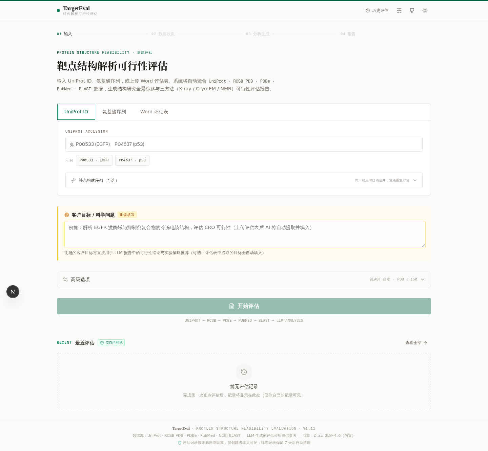
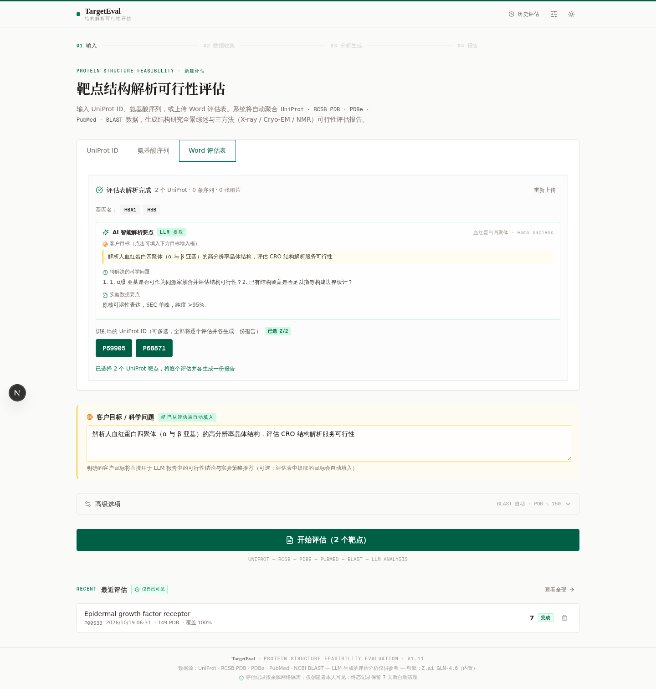
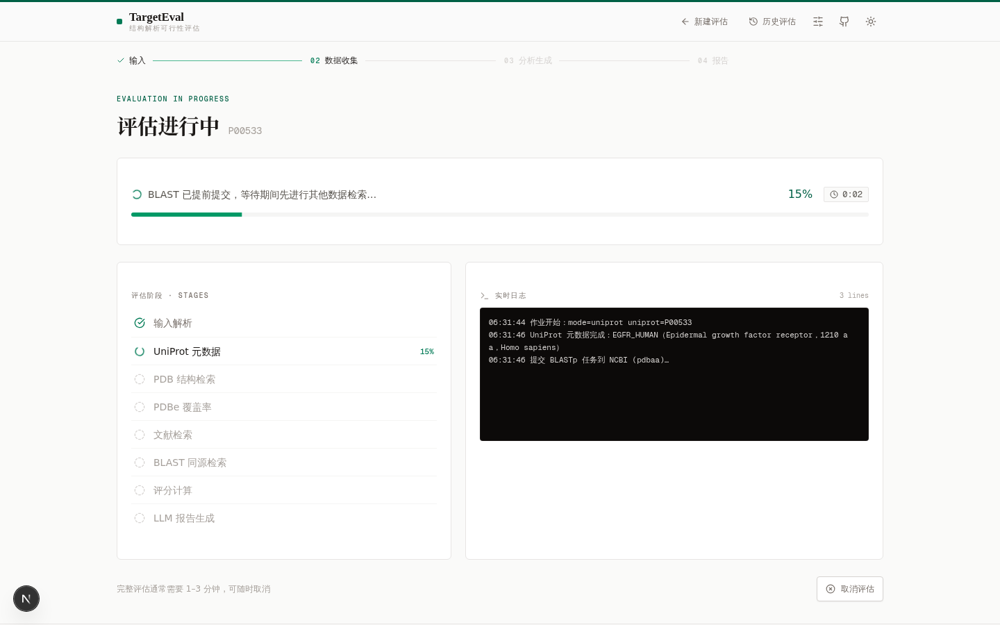
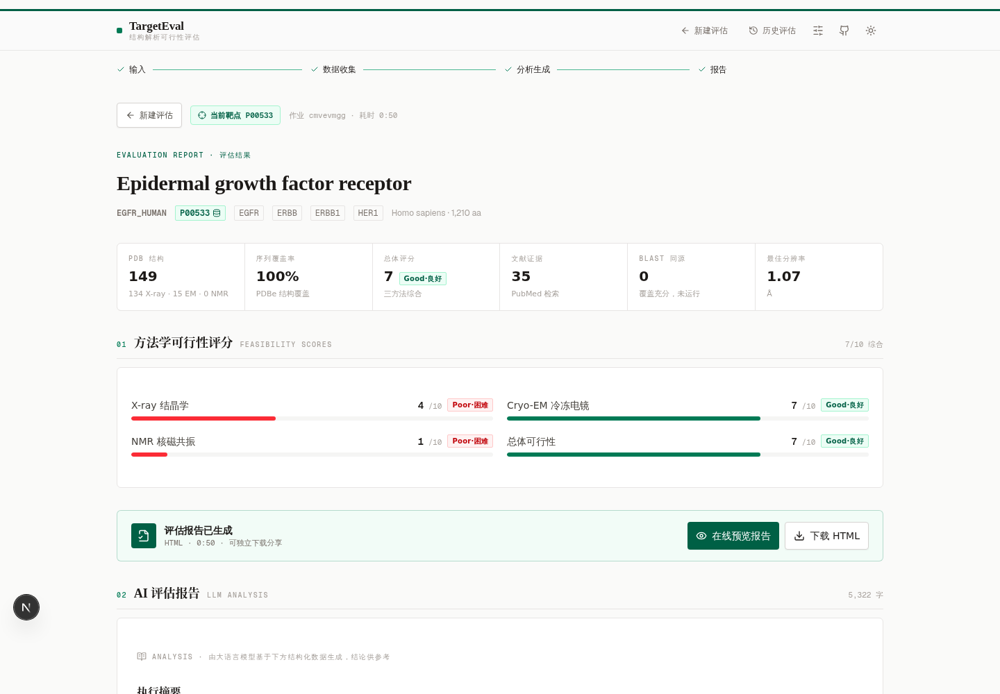
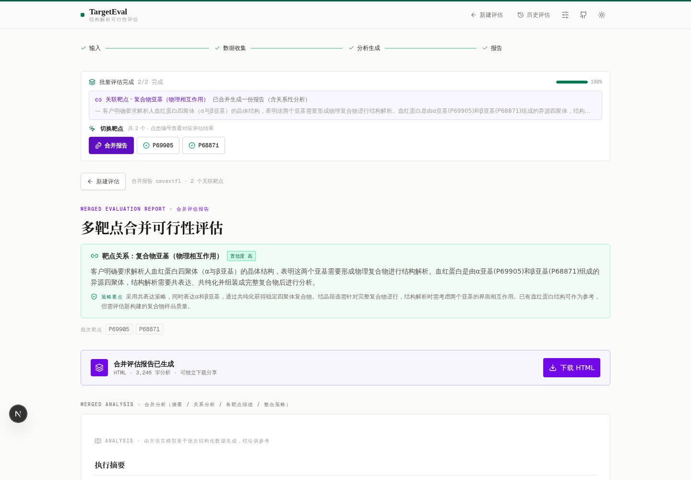
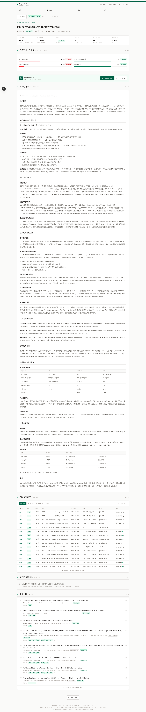
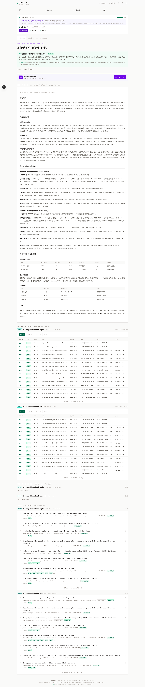
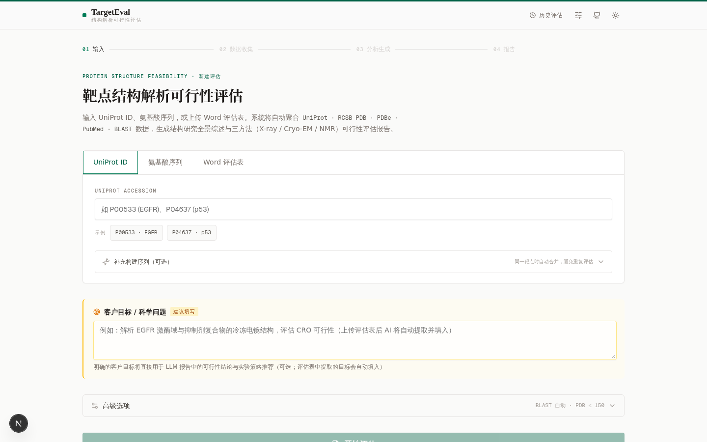

# TargetEval · 靶点结构解析可行性评估平台

<p>
  
  
  
  
  
</p>

输入 **UniProt ID**、**氨基酸序列** 或 **Word 评估表**，自动聚合 UniProt / RCSB PDB / PDBe / PubMed / NCBI BLAST 多数据库数据，完成方法学可行性评分，并由 LLM 生成期刊排版的 HTML 评估报告 —— 为蛋白靶点结构解析（CRO）项目提供可行性决策依据。

<p align="center">
  
</p>

---

## 界面预览

| 评估表智能解析 | 实时进度 |
|:---:|:---:|
| **Word 评估表上传** — AI 提取客户目标 / 科学问题 / 实验要点，自动识别靶点 | **进度面板** — 步骤条 + 阶段列表 + 实时日志 |
|  |  |

| 单靶点评估结果 | 多靶点合并报告 |
|:---:|:---:|
| **结果页** — 可行性评分格栅 + 关键指标 + 编号章节 | **合并报告** — 靶点关系判定 + 家族级执行摘要 |
|  |  |

<details>
<summary><b>📄 完整结果页 / 合并报告长图</b>（点击展开）</summary>

**单靶点评估结果**（P00533 · EGFR）— LLM 分析内联渲染 + PDB / 同源 / 文献数据章节：



**合并评估报告**（P69905 + P68871 血红蛋白 α/β 家族）— 关系分析 + 各靶点综述 + 跨靶点对比矩阵：



</details>

<details>
<summary><b>🌙 深色模式</b>（点击展开）</summary>



</details>

---

## 核心特性

### 🧬 三种输入，一个流程

- **UniProt ID**：如 `P00533`（EGFR）；可附**构建序列** — 同靶点自动合并为一次评估并分析构建边界（对应全长区间）
- **氨基酸序列**：FASTA 或裸序列；自动回填 UniProt 条目，失败由 BLAST 兜底
- **Word 评估表**（.docx ≤ 20MB）：一键解析出
  - UniProt ID / 基因名 / 蛋白序列（多 UniProt 批量评估，上限 5 个）
  - **AI 智能解析要点**（LLM 提取）：客户目标、待解决科学问题、实验数据要点、同源信息、风险关注点
  - **实验图片**：SDS-PAGE 胶图 / SEC 色谱图自动分类展示并嵌入报告 — 全格式支持（PNG/JPG/GIF/WebP/BMP/TIFF/EMF/WMF，矢量图 LibreOffice 转 PNG、超大图自动降采样）；**VLM 逐图识别**类型与关键读数（泳道数、条带单一性、主峰对称性），带 `AI` 角标
  - **抗体序列识别**：IgG 恒定区 / 铰链区保守基序 + 框架区签名判定（Fab/Fc/scFv/VHH），抗体自动跳过 BLAST 并在结果中说明理由

### 🔗 靶点关系判断与家族级合并报告

批量评估前 LLM 先判断靶点间关系（复合物亚基 / 抗体-抗原 / 融合构建 / 同源家族 / 独立）：

- **确定性同源检测**：零依赖种子-对角链算法对全长序列两两比对，任一配对 **≥40% 一致性直接判定同源家族**（LLM 不可否决 — 引用具体数字）
- **评估表序列归属全覆盖**：每条序列经系统比对给出去向 — 客户构建（≥85%）/ 同源家族成员 / 抗体 / 未匹配，不再静默丢弃
- **≥90% 高一致组共享一次 BLAST 检索**：组内代表统一检索，其余成员跳过，完成后命中自动传播（状态注明「共享自家族代表」）
- 关联批次 → 一份**合并报告**：执行摘要（家族级可行性结论）/ 靶点关系分析 / 各靶点综述（500-700 字/靶点）/ 跨靶点对比矩阵 / 整合实验方案 / 时间规划
- 合并视图附**三个带 UniProt 归属的数据章节**：各靶点 PDB 结构、同源结构（BLAST/序列检索）、各靶点文献

### ⚡ 异步任务架构（全程无网关超时）

所有分钟级操作均为**后台任务 + 前端轮询**，单请求毫秒级返回，公网网关（~30s 超时）不再 502：

```
评估作业        POST /api/evaluate           → 毫秒级返回 jobId，进度 2s 轮询
评估表上传      init → chunk×N → complete    → 分块 2MB，后台队列解析
合并报告 v1.12  POST /api/evaluate/batch-report → 立即返回 running，LLM 三段式后台生成
```

- **BLAST 双通道**：NCBI blastp（提交前置，与 RCSB/PDBe/PubMed 并行推进）+ **RCSB mmseqs2 序列检索兜底**（NCBI 队列拥堵 >90s / FAILED / 网络不可达时自动切换，1-3s 返回）
- **BLAST 状态显性化**：结构覆盖充分跳过 / 抗体跳过 / 失败重试建议 — 结果页与报告中恒有章节、从不「无声消失」，LLM 数据上下文同步收到状态说明，杜绝虚构

### 📊 可行性评分与期刊风报告

- **三方法独立评分**（1-10）：X-ray / Cryo-EM / NMR — 基于序列长度、跨膜特征、结构先例（方法+分辨率）、覆盖率、BLAST identity，附评分依据
- **HTML 报告**（单文件、内联 CSS、图片 base64、打印友好）：
  - 期刊版式：学术风封面头（双线刊头 + 元数据栅格 + 目录）、衬线标题、等宽数据表格
  - 章节齐备：执行摘要（结论先行）/ 客户目标与可行性结论（分级+依据+风险）/ 生物学背景 / 结构研究全景（时间线/方法学分布/构象状态）/ 实验数据评估 / 构建设计 / 确定性数据区块（PDB 清单、BLAST 表、文献列表 — 模板直渲防幻觉）
  - PDB ↔ 文献关联：主引文置前标「结构解析文献」，文献下挂关联结构 chips，长列表折叠打印自动展开
- **网页内联渲染**：LLM 报告全文落库持久化，结果页直接阅读（react-markdown），在线预览 / 下载 HTML 双入口

### 🔧 LLM 引擎可配置（多供应商）

顶栏 ⚙️ 面板，开箱即用零配置：

- **内置**：Z.ai GLM-4.6（默认）
- **OpenAI 兼容**：OpenAI / DeepSeek / 通义千问 / 智谱 GLM / Kimi / MiniMax / 豆包 / Grok / OpenRouter / Ollama / 自定义端点
- **原生协议**：Anthropic（Claude）、Google（Gemini）
- 自动拉取模型列表（≤300）· 保存前测试连通性 · Key 仅存本地 SQLite、前端脱敏

### 🛡️ 公网多用户加固

- **数据隔离（按来源 IP）**：归属键 = 来源 IP 的 SHA-256 前 24 位（DB 不落明文 IP）；作业 / 报告 / 图片 / 合并报告仅创建者可访问，跨用户一律 404/403
- **并发与配额防 OOM**：全局排队 ≤8、每 IP 活跃 ≤2、每 IP 24h 评估 ≤30 / 上传 ≤20、docx 解析信号量 ≤2、终态作业 TTL 7 天自动清理（DB+磁盘）
- **轻量运行**：4GB 沙箱可流畅跑 — 外部 API LRU 缓存、PDB 详情分批拉取、图片处理有界、报告 HTML 落盘 SQLite 只存摘要、`MALLOC_ARENA_MAX=2` + 堆上限 1400MB

---

## 工作流程

```
┌─ 输入 ──────────────────────────────────────────────┐
│  UniProt ID / 序列 / Word 评估表（AI 解析 + 图片提取） │
└──────────────────────┬──────────────────────────────┘
                       ▼  多靶点 → LLM 关系判断（同源≥40% 确定性优先）
┌─ 数据收集（并行推进）────────────────────────────────┐
│  UniProt 元数据 → BLAST 提交前置（RID 即返）          │
│  RCSB PDB 结构检索 · PDBe 覆盖率 · PubMed 文献        │
│  ↳ BLAST 收集（NCBI 拥堵时 RCSB mmseqs2 兜底）        │
└──────────────────────┬──────────────────────────────┘
                       ▼  ≥90% 家族组共享检索 · 命中传播
┌─ 分析生成 ───────────────────────────────────────────┐
│  三方法可行性评分 → LLM 三段式报告（输入输出体积受限）  │
│  单靶点报告 / 关联批次合并报告（v1.12 异步生成）        │
└──────────────────────┬──────────────────────────────┘
                       ▼
        期刊风 HTML 报告（落盘+落库）· 网页内联渲染 · 下载
```

## 数据源

| 数据源 | 用途 |
|---|---|
| UniProt REST | 蛋白元数据、序列、结构域 / 跨膜 / 信号肽 features |
| RCSB PDB | 结构检索、entry 详情（方法/分辨率/配体/PMID）、GraphQL 批量配体、**mmseqs2 序列检索兜底** |
| PDBe (EBI) | best_structures 覆盖率、覆盖区间 / 空白区分析 |
| NCBI BLAST | blastp vs pdbaa 同源检索（提交前置 + 退避重试 + RCSB 兜底） |
| PubMed eutils | 结构生物学文献（标题/期刊/DOI/摘要） |

## 快速开始

```bash
bun install
cp .env.example .env          # 配置 DATABASE_URL
bun run db:push               # 初始化 SQLite schema
bun run dev                   # http://localhost:3000
```

生产构建：`bun run build && bun start`

> 首次启动即用内置 Z.ai 引擎，无需任何 Key。EMF/WMF 矢量图转换需安装 `soffice`（Debian/Ubuntu: `apt-get install libreoffice-core`），未安装时自动跳过不影响其余功能。

## 技术栈

Next.js 16（App Router）· TypeScript · Tailwind CSS 4 · shadcn/ui · Prisma + SQLite · framer-motion · z-ai-web-dev-sdk（内置引擎，仅后端）· 可配置外部 LLM（OpenAI 兼容 / Anthropic / Gemini）· mammoth（docx）· sharp（图片）

## API 一览

> 所有涉及用户数据的接口均按来源 IP 隔离（仅创建者可访问自己的资源）。

| 方法 | 路径 | 说明 |
|---|---|---|
| POST | `/api/evaluate` | 创建评估作业（uniprot / sequence / docx；可附构建序列）→ 异步执行 |
| POST | `/api/evaluate/upload/init` | 分块上传①：建会话 + 配额检查 → `{uploadId, chunkSize}` |
| PUT | `/api/evaluate/upload/chunk?uploadId&offset` | 分块上传②：2MB 原始二进制块，逐块重试 |
| POST | `/api/evaluate/upload/complete` | 分块上传③：触发**后台异步解析**（毫秒级返回） |
| GET | `/api/evaluate/upload/status?uploadId` | 分块上传④：轮询解析状态 |
| POST | `/api/evaluate/insights` | 评估表 LLM 智能解析（结果缓存，25s 兜底） |
| POST | `/api/evaluate/relation` | 靶点关系判断（确定性同源 ≥40% 优先，失败降级独立不阻塞） |
| POST | `/api/evaluate/batch-report` | **v1.12 异步**：立即返回 running，LLM 三段式后台生成合并报告 |
| GET | `/api/evaluate/batch-report?id=` | 查询合并报告状态 / 内容（`&download=1` 下载 HTML） |
| GET | `/api/jobs` · `/api/jobs/{id}` | 本人作业列表 · 详情 / 进度轮询 |
| DELETE | `/api/jobs/{id}` | 取消 / 删除作业（含磁盘产物） |
| GET | `/api/jobs/{id}/report` | 单靶点 HTML 报告（`?download=1` 下载） |
| GET | `/api/assets/{id}` | 评估表实验图片流（仅归属者） |
| GET | `/api` | 健康检查 + 服务器负载 |
| GET/POST/DELETE | `/api/llm/config` | LLM 引擎配置（Key 脱敏返回） |
| POST | `/api/llm/models` · `/api/llm/test` | 拉取模型列表 · 测试连通性 |

## 项目结构

```
src/
  app/
    page.tsx                     # 单页应用（输入 → 进度 → 结果 三态视图）
    api/                         # evaluate / jobs / assets / llm 路由
  components/eval/               # 输入面板 / 进度面板 / 结果视图 / 合并视图 / LLM 配置等
  lib/eval/
    pipeline.ts                  # 评估管线编排（多阶段）
    uniprot.ts / rcsb.ts / pdbe.ts / blast.ts / pubmed.ts   # 数据源访问层
    blast-family.ts              # ≥90% 家族组共享检索 + 命中传播
    homology.ts                  # 种子-对角链同源检测（家族判定）
    seq-compare.ts               # 轻量序列比对（同靶点 + 构建边界）
    docx.ts / docx-llm.ts / image-process.ts   # 评估表解析 / LLM 要点提取 / 图片管线
    score.ts                     # 三方法可行性评分
    llm-provider.ts / llm.ts / report.ts / report-merged.ts / report-html.ts
    job-manager.ts / gatekeeper.ts / request-guard.ts / upload-owner.ts
                                 # 作业队列 / 并发配额 / IP 隔离 / 上传归属
prisma/schema.prisma             # EvaluationJob + BatchReport + ReportAsset + LlmConfig
scripts/                         # BLAST 队列诊断 / 同源算法回归等运维脚本
```

## 公网部署要点

1. **置于反向代理之后**并传递真实 IP（Caddy 示例）：
   ```caddy
   example.com {
     reverse_proxy localhost:3000 {
       header_up X-Forwarded-For {remote_host}
       header_up X-Real-IP {remote_host}
     }
   }
   ```
   未接代理时直连请求同属 `direct` 归属组（本地调试用；公网必须接代理隔离用户）
2. **网关超时**：所有请求均为短请求（分块上传 / 后台解析 / 异步报告），<60s 超时的网关无需特殊配置
3. **数据与备份**：`db/custom.db` 与 `db/reports/` 含用户数据；终态记录 7 天自动清理
4. **配额环境变量**：`EVAL_MAX_QUEUE`(8) · `EVAL_MAX_ACTIVE_PER_IP`(2) · `EVAL_MAX_JOBS_PER_DAY`(30) · `EVAL_MAX_UPLOADS_PER_DAY`(20) · `EVAL_PARSE_CONCURRENCY`(2) · `EVAL_JOB_CONCURRENCY`(2) · `EVAL_JOB_TTL_DAYS`(7)
5. 外部 LLM API Key 明文存本地 SQLite，面向内网 / 单机沙箱设计；不可信人群公网开放前建议改用内置引擎或为配置面板加访问控制

## 版本演进

| 版本 | 要点 |
|---|---|
| v1.3-v1.5 | 评估表解析修复 · 图片管线强化 · 公网多用户加固（IP 隔离 + 并发/配额） |
| v1.6 | 分块上传 + 后台异步解析（修复公网网关 30s 超时 502） |
| v1.7 | BLAST 执行状态显性化 · 网页内联报告 · 抗体序列识别 · 批量靶点切换 |
| v1.8 | 关系判断 + 合并报告 · BLAST 提交前置并行 · RCSB 序列检索兜底 · 并发池 |
| v1.10 | 同源靶点自动归并（种子-对角链 ≥40% 判定）· 序列归属全覆盖 |
| v1.11 | ≥90% 家族组共享 BLAST · 合并报告详化（500-700 字/靶点 + 三数据章节）· 图片按作业独立登记 |
| **v1.12** | **合并报告异步生成**（POST 立即返回 running + 前端轮询，修复 LLM 三段式分钟级生成触发网关 502） |

## 说明

- LLM 生成的「评估分析」基于检索数据上下文，可能存在解读偏差；关键决策请以原始数据库与文献为准
- 仅支持 .docx（旧版 .doc 请先另存）；BLAST 依赖 NCBI 队列，高峰期可能 1-5 分钟或超时跳过（不影响其余阶段，RCSB 兜底自动接管）
- 数据隔离基于来源 IP（无账号体系），同一出口 IP（公司 / NAT）下共享归属组

## License

MIT
