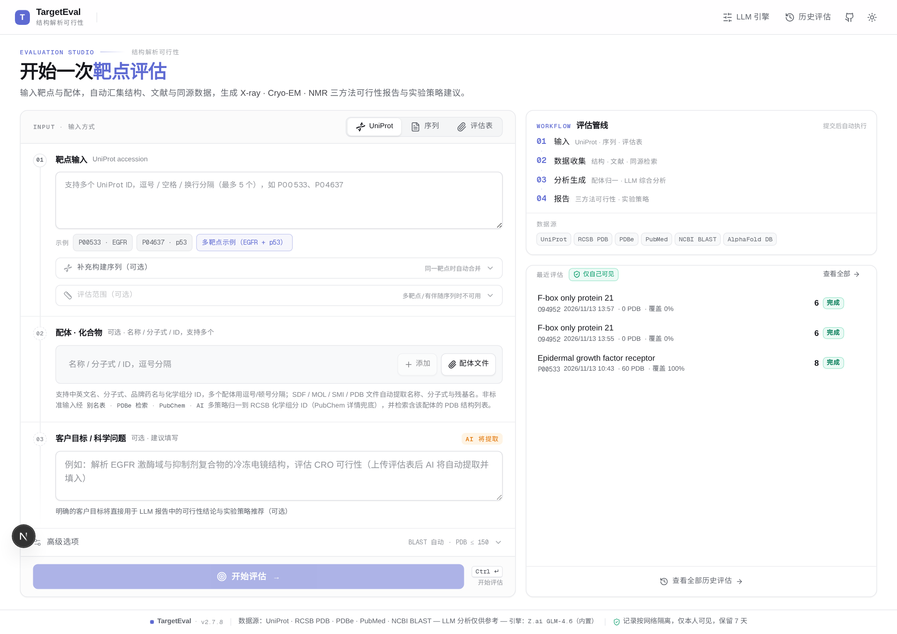
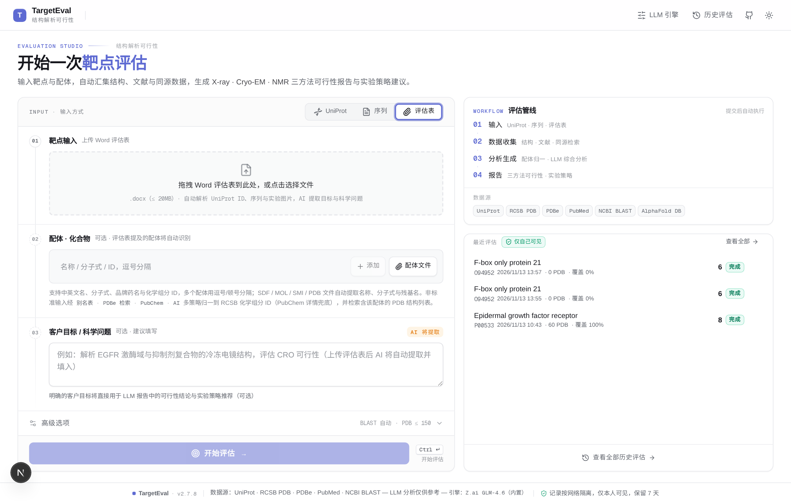
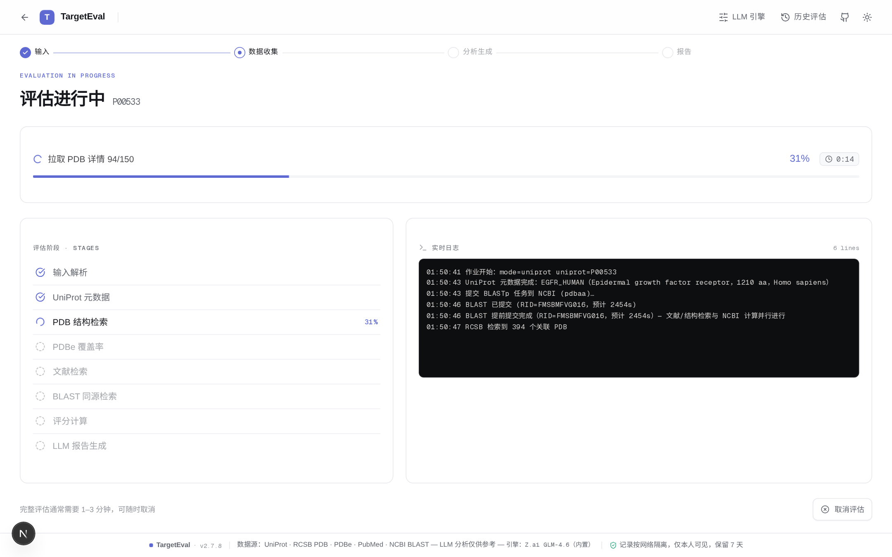
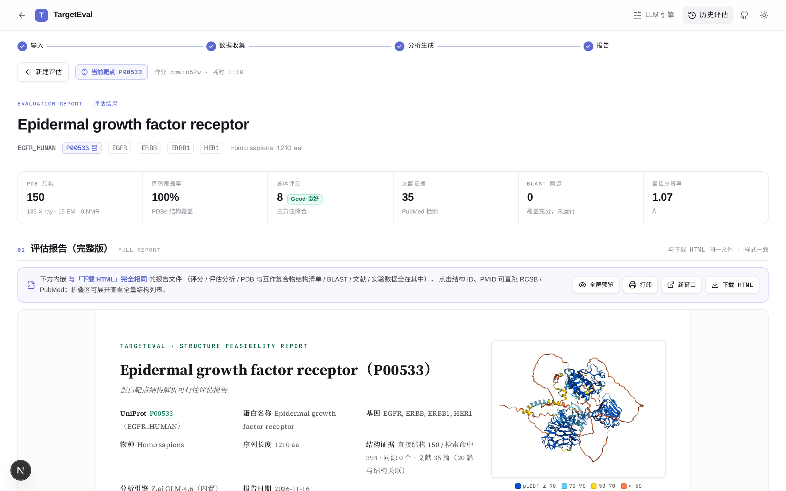
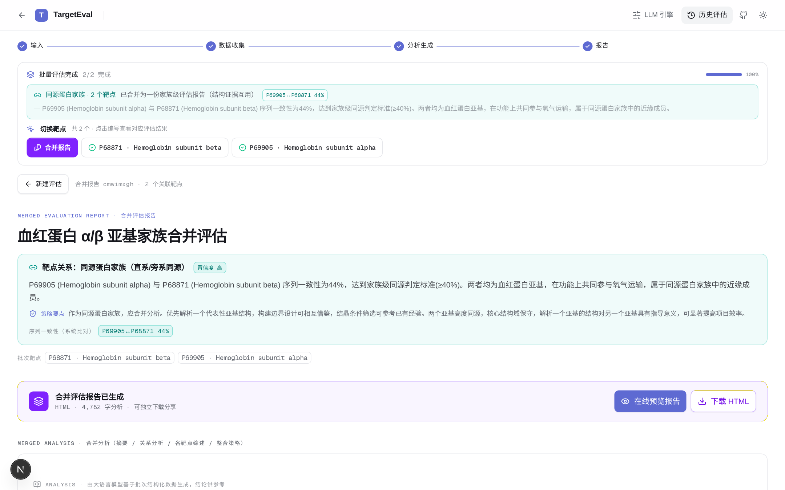
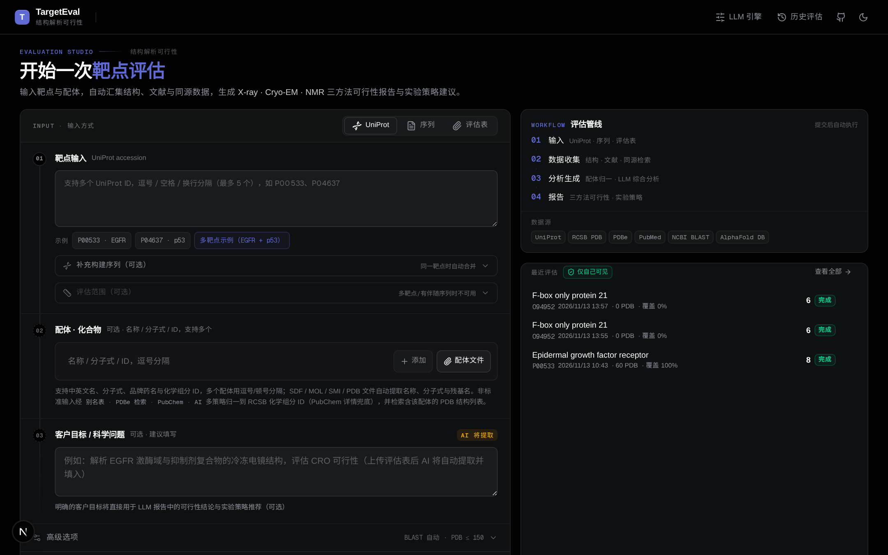

# TargetEval · 靶点结构解析可行性评估平台

<p>
  
  
  
  
  
</p>

输入 **UniProt ID**、**氨基酸序列** 或 **Word 评估表**，自动聚合 UniProt / RCSB PDB / PDBe / PubMed / NCBI BLAST 多数据库数据，完成方法学可行性评分，并由 LLM 生成期刊排版的 HTML 评估报告 —— 为蛋白靶点结构解析（CRO）项目提供可行性决策依据。

<p align="center">
  
</p>

---

## 界面预览

| 评估表智能解析 | 实时进度 |
|:---:|:---:|
| **Word 评估表上传** — AI 提取客户目标 / 科学问题 / 实验要点，自动识别靶点 | **进度面板** — 步骤条 + 阶段列表 + 实时日志 |
|  |  |

| 单靶点评估结果 | 多靶点合并报告 |
|:---:|:---:|
| **结果页** — 摘要头 + 内嵌完整报告（3D 视图 · 配体卡 · 数据章节） | **合并报告** — web 内嵌完整 HTML 报告（与下载同一份）· 靶点关系判定 + 评估表逐条回应 |
|  |  |

<details>
<summary><b>📄 完整结果页 / 合并报告长图</b>（点击展开）</summary>

**单靶点评估结果**（P00533 · EGFR + 配体 erlotinib/ATP）— 内嵌完整 HTML 报告：AlphaFold 预测结构 3D 视图（pLDDT 着色）、配体 2D 结构式卡（计算性质 + 标识符一键复制）、覆盖率区段图、PDB / BLAST / 文献章节：


**合并评估报告**（P69905 + P68871 血红蛋白 α/β 家族）— 关系分析（确定性同源证据 44%）+ 各靶点综述 + 跨靶点对比矩阵：


</details>

<details>
<summary><b>🌙 深色模式</b>（点击展开）</summary>



</details>

---

## 核心特性

### 🧬 三种输入，一个流程

- **UniProt ID**：如 `P00533`（EGFR）；可附**构建序列** — 同靶点自动合并为一次评估并分析构建边界（对应全长区间）
- **氨基酸序列**：FASTA 或裸序列；自动回填 UniProt 条目，失败由 BLAST 兜底
- **Word 评估表**（.docx ≤ 20MB）：一键解析出
  - UniProt ID / 基因名 / 蛋白序列（多 UniProt 批量评估，v2.8 起不设靶点数上限 — 后端防御性上限 30，关系判断与合并报告全量参与）
  - **AI 智能解析要点**（LLM 提取）：客户目标、待解决科学问题、实验数据要点、同源信息、风险关注点
  - **实验图片**：SDS-PAGE 胶图 / SEC 色谱图自动分类展示并嵌入报告 — 全格式支持（PNG/JPG/GIF/WebP/BMP/TIFF/EMF/WMF，矢量图 LibreOffice 转 PNG、超大图自动降采样）；**VLM 逐图识别**类型与关键读数（泳道数、条带单一性、主峰对称性），带 `AI` 角标
  - **抗体序列识别**：IgG 恒定区 / 铰链区保守基序 + 框架区签名判定（Fab/Fc/scFv/VHH），抗体自动跳过 BLAST 并在结果中说明理由

### 🔗 靶点关系判断与家族级合并报告

批量评估前 LLM 先判断靶点间关系（复合物亚基 / 抗体-抗原 / 融合构建 / 同源家族 / 独立）：

- **确定性同源检测**：零依赖种子-对角链算法对全长序列两两比对，任一配对 **≥40% 一致性直接判定同源家族**（LLM 不可否决 — 引用具体数字）
- **评估表序列归属全覆盖**：每条序列经系统比对给出去向 — 客户构建（≥85%）/ 同源家族成员 / 抗体 / 未匹配，不再静默丢弃
- **≥90% 高一致组共享一次 BLAST 检索**：组内代表统一检索，其余成员跳过，完成后命中自动传播（状态注明「共享自家族代表」）
- 关联批次 → 一份**合并报告**：执行摘要（家族级可行性结论）/ 靶点关系分析 / 各靶点综述（500-700 字/靶点）/ 跨靶点对比矩阵 / 整合实验方案 / 时间规划
- 合并视图附**三个带 UniProt 归属的数据章节**：各靶点 PDB 结构、同源结构（BLAST/序列检索）、各靶点文献
- **合并报告格式（v2.8）**：全章节连续编号方块（目录同号）· 刊头靶点卡 mini 仪表盘（PDB/最佳分辨率/覆盖率/同源/文献）· 对比矩阵扩列（寡聚态 / 同源结构 / 文献 / 总体评级）· 目录「靶点速览」锚点直达各靶点结构折叠块 · 靶点 ≥4 时数据折叠块智能收起防长报告失控
- **各靶点单独报告（v2.9）**：合并报告内嵌每个靶点的独立简报卡（简版，不重复单独评估的全部明细）— 基本信息栏（方法评分 / 总体可行性 / 实验结构统计 / 序列覆盖区间 / 同源 / 文献配体 / 聚集形式 / 分子量 / 客户构建）+ **AlphaFold 预测结构交互 3D 视图**（pLDDT 置信着色 · 拖拽旋转 / 滚轮缩放 / 全屏放大，每靶点独立内嵌；模型磁盘优先获取，单模型 ≤2.5MB / 批次总预算 12MB，超限降级统计卡 + AFDB 链接）；网页合并视图同步展示简报卡（评分徽标 + AF 元数据 + 外链）
- **客户评估表要点逐条回应（v2.10）**：LLM 第四段「客户评估表问题回应」— 每条**客户目标**附「评估回应」（能否达成 + 依据与建议路径）、每条**待解决科学问题**附「评估回答」（结论先行 + PDB / 共有结构 / 寡聚态 / 文献证据，数据未覆盖处如实标注并给实验验证建议）；渲染端把该章节逐条内嵌到「客户评估表要点与回应」章节对应条目下方（回答紧跟问题，不再只列问题不回答；LLM 偏离格式时整块降级呈现，旧报告可经 `scripts/upgrade-merged-qa.ts` 补答升级）
- **Web 合并视图内嵌完整 HTML 报告（v2.10，与单独评估同构）**：结果页 iframe 直接嵌同一份 HTML（`?inline=1` 与下载共用文件，展示 100% 一致；自动高度同步 + 加载失败降级旧 React 数据视图）— 根除 React 重绘与离线 HTML 双版本漂移
- **报告文件名 = 报告题目（v2.10）**：合并报告下载文件名改用 LLM 生成的描述性标题（如「BTN-TCR 复合物结构解析可行性评估.html」，RFC 5987 `filename*` 携带中文 + ASCII 回退名），前端自动下载同步优先解析 `filename*`

### 🧪 配体归一与结构式卡

- **「非标准输入 → RCSB 化学组分 ID」五策略解析链**：直接组分 ID 校验（ATP / STU / A1H2J…）→ 中英文别名表 → PDBe Solr 全文检索（名称词面验证，防共结晶噪声）→ PubChem 名称 + SMILES 结构反查（分子式硬校验）→ LLM 中文俗名兜底（候选一律经 chemcomp 分子式硬校验，绝不直接采信 — 防幻觉错配）
- **抗体/蛋白类试剂拦截（v2.8）**：评估表中的抗体克隆（如「027 scFv」）、Fab / Fc / nanobody / VHH / 免疫球蛋白 / 重轻链描述不进入配体归一 — 提示词约束 + 提名硬过滤 + 归一入口拦截三道防线（RCSB 实测 FAB/VHH/VHL/IGM/CDR 本身是合法化学组分 ID，真实组分仍可直通，仅拦非组分形态）
- **报告配体卡**：2D 化学结构式（RCSB CCD 矢量 SVG，放大不失真；无组分 ID 回落 PubChem 600px PNG）· XLogP / TPSA / 氢供受体 / 可旋转键 / 重原子 / 精确质量等计算性质 · InChIKey / SMILES 标识符一键复制
- **含该配体的 PDB 结构列表**（PDBe Solr 字段化检索）；2D 图与性质磁盘缓存（`db/cache/ligand2d/`），合并报告渲染前对旧作业自动回补缺失图

### ⚡ 任务架构 — 异步作业 / 流式双模式（全程无网关超时）

所有分钟级操作均为**后台任务 + 前端轮询**（常规部署）或 **NDJSON 流式 + 心跳 + 分段续跑**（无状态部署 — 前端探测分块上传会话跨请求不可见时自动切换并记忆），公网网关（~30s 超时）不再 502：

```
评估作业        POST /api/evaluate           → 毫秒级返回 jobId，进度 2s 轮询
无状态评估      POST /api/evaluate/sync      → NDJSON 流（心跳 + 14s 段 checkpoint 续跑）
评估表上传      init → chunk×N → complete    → 分块 2MB，后台队列解析
合并报告 v1.12  POST /api/evaluate/batch-report → 立即返回 running，LLM 四段式（含评估表问题回应）后台生成
```

- **BLAST 双通道**：NCBI blastp（提交前置，与 RCSB/PDBe/PubMed 并行推进）+ **RCSB mmseqs2 序列检索兜底**（NCBI 队列拥堵 >90s / FAILED / 网络不可达时自动切换，1-3s 返回）
- **BLAST 状态显性化**：结构覆盖充分跳过 / 抗体跳过 / 失败重试建议 — 结果页与报告中恒有章节、从不「无声消失」，LLM 数据上下文同步收到状态说明，杜绝虚构

### 📊 可行性评分与期刊风报告

- **三方法独立评分**（1-10）：X-ray / Cryo-EM / NMR — 基于序列长度、跨膜特征、结构先例（方法+分辨率）、覆盖率、BLAST identity，附评分依据
- **HTML 报告**（单文件、内联 CSS、图片 base64、打印友好）：
  - 期刊版式：学术风封面头（双线刊头 + 元数据栅格 + 目录）、衬线标题、等宽数据表格
  - 章节齐备：执行摘要（结论先行）/ 客户目标与可行性结论（分级+依据+风险）/ 生物学背景 / 结构研究全景（时间线/方法学分布/构象状态）/ 实验数据评估 / 构建设计 / 确定性数据区块（PDB 清单、BLAST 表、文献列表 — 模板直渲防幻觉）
  - PDB ↔ 文献关联：主引文置前标「结构解析文献」，文献下挂关联结构 chips，长列表折叠打印自动展开
- **网页内联渲染**：LLM 报告全文落库持久化，结果页直接阅读（react-markdown），在线预览 / 下载 HTML 双入口

### 🔍 报告阅读体验 — 3D 交互 · 灯箱放大 · A4 打印 · 响应式

- **AlphaFold 预测结构 3D 交互视图**（v2.7.2）：报告内嵌 3Dmol + PDB 文本 — 离线单文件可交互（拖拽旋转 / 滚轮缩放 / 双指捏合 / pLDDT 四桶着色），「放大」一键全屏、退出归位；服务端零浏览器依赖。结构元数据 sidecar + PDB 磁盘缓存（7 天新鲜窗口零网络直读）— 部署节点断网时已评估靶点仍出完整区块（v2.7.4）
- **图片点击放大 · 灯箱**（v2.7.5）：配体结构式 / 客户实验图 / AlphaFold 静态图 — 滚轮锚定光标缩放 · 双指捏合 · 拖拽平移 · 双击 2.5× 复位；应用内嵌预览自动「可视切片」贴屏定位（避让宿主吸顶栏 + 父页滚动锁，v2.7.7/2.7.8），独立打开为全屏；纯内联零依赖、打印自动隐藏
- **A4 打印分页**（v2.7.6）：`@page` 边距 + 标题不孤行 / 卡片不腰斩 + 数据表表头跨页重复 + 控件打印隐藏 — 直接打印即归档版 PDF
- **覆盖率区段可视化**（v2.7.6）：服务端 SVG 轨道图（已覆盖绿 / 未覆盖琥珀 + 悬停区间明细 + 残基刻度），零 JS 打印友好
- **响应式版心**（v2.7.3）：宽屏分级放宽 920→1600px（≥1280 数据表免横向滚动、配体卡多列铺开），移动端防溢出 + 表格横滚渐变指示
- **旧报告自动升级**：历史作业报告 serve 时注入上述能力（marker 幂等检测，已内嵌旧版本自动清理重挂 — 无需重新评估）

### 🔧 LLM 引擎可配置（多供应商）

顶栏 ⚙️ 面板，开箱即用零配置：

- **内置**：Z.ai GLM-4.6（默认）
- **OpenAI 兼容**：OpenAI / DeepSeek / 通义千问 / 智谱 GLM / Kimi / MiniMax / 豆包 / Grok / OpenRouter / Ollama / 自定义端点
- **原生协议**：Anthropic（Claude）、Google（Gemini）
- 自动拉取模型列表（≤300）· 保存前测试连通性 · Key 仅存本地 SQLite、前端脱敏

### 🛡️ 公网多用户加固

- **数据隔离（按来源 IP）**：归属键 = 来源 IP 的 SHA-256 前 24 位（DB 不落明文 IP）；作业 / 报告 / 图片 / 合并报告仅创建者可访问，跨用户一律 404/403
- **并发与配额防 OOM**：全局排队 ≤8、每 IP 活跃 ≤2、每 IP 24h 评估 ≤30 / 上传 ≤20、docx 解析信号量 ≤2、终态作业 TTL 7 天自动清理（DB+磁盘）
- **轻量运行**：4GB 沙箱可流畅跑 — 外部 API LRU 缓存、PDB 详情分批拉取、图片处理有界、报告 HTML 落盘 SQLite 只存摘要、`MALLOC_ARENA_MAX=2` + 堆上限 1400MB

---

## 工作流程

```
┌─ 输入 ──────────────────────────────────────────────┐
│  UniProt ID / 序列 / Word 评估表（AI 解析 + 图片提取） │
└──────────────────────┬──────────────────────────────┘
                       ▼  多靶点 → LLM 关系判断（同源≥40% 确定性优先）
┌─ 数据收集（并行推进）────────────────────────────────┐
│  UniProt 元数据 → BLAST 提交前置（RID 即返）          │
│  RCSB PDB 结构检索 · PDBe 覆盖率 · PubMed 文献        │
│  ↳ BLAST 收集（NCBI 拥堵时 RCSB mmseqs2 兜底）        │
└──────────────────────┬──────────────────────────────┘
                       ▼  ≥90% 家族组共享检索 · 命中传播
┌─ 分析生成 ───────────────────────────────────────────┐
│  三方法可行性评分 → LLM 三段式报告（输入输出体积受限）  │
│  单靶点报告 / 关联批次合并报告（v1.12 异步生成）        │
└──────────────────────┬──────────────────────────────┘
                       ▼
        期刊风 HTML 报告（落盘+落库）· 网页内联渲染 · 下载 · 3D 视图 / 灯箱放大 / A4 打印
```

## 数据源

| 数据源 | 用途 |
|---|---|
| UniProt REST | 蛋白元数据、序列、结构域 / 跨膜 / 信号肽 features |
| RCSB PDB | 结构检索、entry 详情（方法/分辨率/配体/PMID）、GraphQL 批量配体、**CCD 矢量结构式图**、**mmseqs2 序列检索兜底** |
| PDBe (EBI) | best_structures 覆盖率、覆盖区间 / 空白区分析 · Solr 配体检索 |
| AlphaFold DB | 预测结构 PDB + pLDDT 指标（报告内嵌 3D 视图数据源；磁盘缓存离线可用） |
| PubChem | 配体 2D 结构式图（PNG 回落）+ XLogP/TPSA 等计算性质 + SMILES 结构反查 |
| NCBI BLAST | blastp vs pdbaa 同源检索（提交前置 + 退避重试 + RCSB 兜底） |
| PubMed eutils | 结构生物学文献（标题/期刊/DOI/摘要） |

## 快速开始

```bash
bun install
cp .env.example .env          # 配置 DATABASE_URL
bun run db:push               # 初始化 SQLite schema
bun run dev                   # http://localhost:3000
```

生产构建：`bun run build && bun start`

> 首次启动即用内置 Z.ai 引擎，无需任何 Key。EMF/WMF 矢量图转换需安装 `soffice`（Debian/Ubuntu: `apt-get install libreoffice-core`），未安装时自动跳过不影响其余功能。

## 技术栈

Next.js 16（App Router）· TypeScript · Tailwind CSS 4 · shadcn/ui · Prisma + SQLite · framer-motion · z-ai-web-dev-sdk（内置引擎，仅后端）· 可配置外部 LLM（OpenAI 兼容 / Anthropic / Gemini）· mammoth（docx）· sharp（图片）

## API 一览

> 所有涉及用户数据的接口均按来源 IP 隔离（仅创建者可访问自己的资源）。

| 方法 | 路径 | 说明 |
|---|---|---|
| POST | `/api/evaluate` | 创建评估作业（uniprot / sequence / docx；可附构建序列）→ 异步执行 |
| POST | `/api/evaluate/sync` | 同步流式评估（NDJSON 进度 + 心跳 + 14s 段 checkpoint 续跑）— 无状态部署主路径，前端自动探测切换 |
| POST | `/api/evaluate/upload/init` | 分块上传①：建会话 + 配额检查 → `{uploadId, chunkSize}` |
| PUT | `/api/evaluate/upload/chunk?uploadId&offset` | 分块上传②：2MB 原始二进制块，逐块重试 |
| POST | `/api/evaluate/upload/complete` | 分块上传③：触发**后台异步解析**（毫秒级返回） |
| GET | `/api/evaluate/upload/status?uploadId` | 分块上传④：轮询解析状态 |
| POST | `/api/evaluate/insights` | 评估表 LLM 智能解析（结果缓存，25s 兜底） |
| POST | `/api/evaluate/relation` | 靶点关系判断（确定性同源 ≥40% 优先，失败降级独立不阻塞） |
| POST | `/api/evaluate/batch-report` | **v1.12 异步**：立即返回 running，LLM 四段式后台生成合并报告（含客户评估表逐条回应） |
| GET | `/api/evaluate/batch-report?id=` | 查询合并报告状态 / 内容（`&download=1` 下载 HTML） |
| GET | `/api/jobs` · `/api/jobs/{id}` | 本人作业列表 · 详情 / 进度轮询 |
| DELETE | `/api/jobs/{id}` | 取消 / 删除作业（含磁盘产物） |
| GET | `/api/jobs/{id}/report` | 单靶点 HTML 报告（`?download=1` 下载） |
| GET | `/api/assets/{id}` | 评估表实验图片流（仅归属者） |
| GET | `/api` | 健康检查 + 服务器负载 |
| GET/POST/DELETE | `/api/llm/config` | LLM 引擎配置（Key 脱敏返回） |
| POST | `/api/llm/models` · `/api/llm/test` | 拉取模型列表 · 测试连通性 |

## 项目结构

```
src/
  app/
    page.tsx                     # 单页应用（输入 → 进度 → 结果 三态视图）
    api/                         # evaluate（含 sync / upload / insights / relation / batch-report）· jobs · assets · llm 路由
  components/eval/               # 输入面板 / 进度面板 / 结果视图 / 合并视图 / LLM 配置等
  lib/eval/
    pipeline.ts                  # 评估管线编排（多阶段 + 分段 checkpoint）
    uniprot.ts / rcsb.ts / rcsb-search.ts / pdbe.ts / blast.ts / pubmed.ts   # 数据源访问层（含 mmseqs2 兜底）
    alphafold.ts                 # AlphaFold DB 预测结构（3D 视图数据源 + 磁盘缓存离线优先）
    ligand.ts / ligand-parse.ts / pubchem.ts   # 配体五策略归一链 / 上传配体文件解析 / 2D 图与计算性质
    blast-family.ts              # ≥90% 家族组共享检索 + 命中传播
    homology.ts / relation.ts    # 种子-对角链同源检测（家族判定） / 靶点关系判断编排
    seq-compare.ts               # 轻量序列比对（同靶点 + 构建边界）
    docx.ts / docx-llm.ts / image-process.ts   # 评估表解析 / LLM 要点提取 / 图片管线
    score.ts                     # 三方法可行性评分
    llm-provider.ts / llm.ts / report.ts / report-merged.ts / report-html.ts
                                 # LLM 多供应商适配 / 编排 / 单靶点 / 合并 / HTML 模板（含响应式·灯箱·打印·旧报告注入）
    cache.ts                     # 外部 API LRU + 磁盘缓存
    job-manager.ts / gatekeeper.ts / request-guard.ts / upload-owner.ts / upload-session.ts
                                 # 作业队列 / 并发配额 / IP 隔离 / 上传归属与分块会话
prisma/schema.prisma             # EvaluationJob + BatchReport + ReportAsset + LlmConfig
scripts/                         # E2E（报告 UX / 灯箱 / 响应式 / 部署全链路）· fixture 渲染 · BLAST 队列诊断等运维脚本
```

## 公网部署要点

1. **置于反向代理之后**并传递真实 IP（Caddy 示例）：
   ```caddy
   example.com {
     reverse_proxy localhost:3000 {
       header_up X-Forwarded-For {remote_host}
       header_up X-Real-IP {remote_host}
     }
   }
   ```
   未接代理时直连请求同属 `direct` 归属组（本地调试用；公网必须接代理隔离用户）
2. **网关超时（v2.6/v2.6.3 可续跑分段评估）**：无状态网关切断长连接时，前端自动走分段续跑 — 到点服务端交还 checkpoint 快照，前端立即携快照续跑直至终态（BLAST RID 跨段轮询 / PDB·配体·LLM 报告增量续跑）。**v2.6.3 实测部署网关对流式响应的字节转发窗口仅 ~24-28s**（与心跳内容/节奏无关，服务端 EOF 亦不达客户端，socket ~91s 才被杀）：段预算收紧到 14s（`EVAL_SYNC_SEGMENT_MS` 可调，勿超 ~18s），checkpoint 事件安全落在窗口内；分块上传 / 后台解析 / 异步报告本身均为短请求
3. **智能解析流式心跳（v2.6.2/v2.6.3）**：`/api/evaluate/insights` 为 NDJSON 流，心跳 beat 形态与 `/api/evaluate/sync` 一致（异步首事件 1.2s + ~1.4KB pad + 3s 周期）。**v2.6.3：LLM 预算 40s → 12s（`EVAL_INSIGHTS_BUDGET_MS` 可调，勿超 ~15s）** — 40s 的兜底 done 事件落在网关 ~24s 转发窗之外，客户端只能读流至 ~91s socket 切断抛 TypeError「network error」（用户实测报错）；12s 预算保证 done ≤ ~13s 入队；前端断流识别已覆盖英文 network error / terminated / failed to fetch，三级降级（流式 → 流式重试 → quick 规则兜底）真正生效。`/api/llm/test` 连通性探测同样收紧至 12s 快速失败
4. **数据与备份**：`db/custom.db` 与 `db/reports/` 含用户数据；终态记录 7 天自动清理
5. **部署产物体积（v2.7.1 构建修复）**：`pipeline.ts` / `report-merged.ts` 中引用运行时资源目录（`st.assetDir` = `db/reports/<id>/assets`）的 `path.join` 若不加 `/*turbopackIgnore: true*/`，Turbopack 静态分析无法确定路径，会把**整个项目根**（含 node_modules 全量、沙盒 skills/、docs/ 等，standalone 膨胀至 ~295MB）追踪进部署包，超过平台打包/上传上限 → 部署失败（"Sorry, there was a problem deploying the code"）。已修的三处：`pipeline.ts` resolveImagePath、`pipeline.ts` reportAsset.create.path、`report-merged.ts` embedImages；修复后 standalone ~180MB、部署包 ~68MB。**新增任何构建期不可静态确定的 fs 路径时，务必同样加 turbopackIgnore，或改用 `path.join(process.cwd(), 'db', ...)` 静态子目录形式**
6. **配额环境变量**：`EVAL_MAX_QUEUE`(8) · `EVAL_MAX_ACTIVE_PER_IP`(2) · `EVAL_MAX_JOBS_PER_DAY`(30) · `EVAL_MAX_UPLOADS_PER_DAY`(20) · `EVAL_PARSE_CONCURRENCY`(2) · `EVAL_JOB_CONCURRENCY`(2) · `EVAL_JOB_TTL_DAYS`(7) · `EVAL_SYNC_SEGMENT_MS`(14000，分段评估单段预算) · `EVAL_INSIGHTS_BUDGET_MS`(12000，智能解析 LLM 预算)
7. 外部 LLM API Key 明文存本地 SQLite，面向内网 / 单机沙箱设计；不可信人群公网开放前建议改用内置引擎或为配置面板加访问控制

## 版本演进

| 版本 | 要点 |
|---|---|
| v1.3-v1.5 | 评估表解析修复 · 图片管线强化 · 公网多用户加固（IP 隔离 + 并发/配额） |
| v1.6 | 分块上传 + 后台异步解析（修复公网网关 30s 超时 502） |
| v1.7 | BLAST 执行状态显性化 · 网页内联报告 · 抗体序列识别 · 批量靶点切换 |
| v1.8 | 关系判断 + 合并报告 · BLAST 提交前置并行 · RCSB 序列检索兜底 · 并发池 |
| v1.10 | 同源靶点自动归并（种子-对角链 ≥40% 判定）· 序列归属全覆盖 |
| v1.11 | ≥90% 家族组共享 BLAST · 合并报告详化（500-700 字/靶点 + 三数据章节）· 图片按作业独立登记 |
| **v1.12** | **合并报告异步生成**（POST 立即返回 running + 前端轮询，修复 LLM 三段式分钟级生成触发网关 502） |
| v2.0-v2.3 | 表格内联渲染 · 配体管线（PDB CCD/PDBe/PubChem 归一 + 结构检索）· 无状态（函数计算）部署全链路 |
| v2.4-v2.5 | 评估表 AI 提取配体自动入表 · 规则提取结构化（标签行配对）· PDB 不限选项 · 直传回退 |
| v2.6 | 可续跑分段评估：同步流接口每段 ≤55s 交还 checkpoint，前端携快照续跑（BLAST RID 跨段轮询 / LLM 报告增量），修复网关 ~91s 切断的「未知错误」 |
| v2.6.1 | insights 智能解析流式化（NDJSON + 心跳），初次修复部署节点 502 |
| **v2.6.2** | **insights 心跳形态复刻 sync（异步首事件 + 1.4KB pad + 3s 周期）**：小帧 ping 在部署链路被缓冲吞没的 502 根除；前端三级降级（流式 → 流式重试 → quick 规则兜底）永不卡死；`/api/llm/test` 收紧至 12s 快速失败 |
| **v2.6.3** | **网关转发窗实测定位（~24-28s 字节转发窗，socket ~91s 切断）后全面收紧**：insights LLM 预算 40s→12s（done 必在窗内入队，根除「network error」透出）；sync 段预算 55s→14s；管线闸门随段预算伸缩（BLAST 提交绑定段截止，连续 3 次切断置 failed 走 RCSB 兜底）；LLM 报告段同键连续 3 次失败后放弃重试（规则兜底内容定稿，防慢引擎无限段循环）；前端断流识别覆盖英文 network error/terminated，sync 段流中断自动携 checkpoint 重试 |
| **v2.7** | **报告可读性与 LLM 章节化重构**：① LLM 分析三段式拆为 10 章节级调用（200-800 字/章，实测单章 2-5s，稳落 ~12.5s 段预算内 — 修复 14s 段预算下三段全部 aborted 的「LLM 分析失败」；缺章降级为局部提示而非整体失败）；② AlphaFold 头图区间着色修复（3Dmol resi 数组「任一命中」语义导致区间中段残基不着色 — 结构大片透明看不到 → 改用 `"min-max"` 区间字符串全区间着色，覆盖率 5.0%→8.3%，缓存升 v2 子目录整体失效重渲染）；③ 报告头部双栏重构（头图上提与标题齐平，消除蛋白信息下方空白）；④ 配体卡增强（PubChem 2D 化学结构式图 + XLogP/TPSA/氢供受体/可旋转键/重原子/精确质量等计算性质 + InChIKey/SMILES 标识符折叠，磁盘缓存 ligand2d） |
| **v2.7.1** | **部署产物瘦身修复**：pipeline/report-merged 三处运行时资产路径补 `turbopackIgnore` — 根除 Turbopack 因动态 fs 路径把整个项目根（node_modules 全量 + 沙盒 skills 等 ~295MB standalone）追踪进部署包导致的部署失败；standalone 295MB→180MB、部署包 ~68MB，平台构建脚本端到端复验通过 |
| **v2.7.2** | **AlphaFold 报告内嵌交互式 3D 视图（根治部署节点图片生成失败）**：旧 af2 相位在服务端用 Playwright 无头 Chromium 截图（冷启动 15-40s 且不可中断），远超 14s 段预算与网关 ~24s 转发窗 — 多实例负载均衡下每次重试都重付冷启动，图片永远渲染不完 → 报告缺图。新架构：af2 仅取元数据（apiCache 秒级）；render 相位按需下载 PDB（磁盘缓存 + 12s 上限 + 预算闸门）；报告头内嵌 3Dmol bundle + PDB 文本 + 共用 plddtStyleApplyJs 四段着色 — 拖拽旋转/滚轮缩放，离线单文件可交互，服务端零浏览器依赖；legacy PNG 仅作只读缓存回落/打印海报（viewer 成功后 pngURI 生成）；Playwright 单例毒丸修复（launch 失败不再永久缓存拒绝） |
| **v2.7.3** | **报告响应式版心（宽屏自适应 + 移动端）**：单源 `RESPONSIVE_PAGE_CSS`（marker `rpt-rw-v3`）——版心随视口分级放宽 920→1088→1224→1360→1480→1600px（≥1280 起数据表 856px min-width 免横向滚动、配体卡/图集多列铺开），字号随档位微升（15→17.5px）保行宽可读；窄屏收紧留白 + `minmax(min(400px,100%),1fr)` 防小屏网格撑爆（根除 375px 下 lig-grid 横向溢出）；3D 视图宽屏 360px/280px 扩展。**旧报告兼容**：`/api/jobs/[id]/report` 与 `/api/evaluate/batch-report`（inline/download）serve 时经 `applyResponsiveOverride` 注入覆盖 CSS（marker 幂等检测），历史作业同样自适应；App 报告预览弹窗 `max-w-6xl` → `xl:1280 / 2xl:1560` 分级放宽。E2E：`scripts/e2e-responsive.mjs`（9 档视口断言 + 截图）+ `scripts/render-resp-fixtures.ts`（fixture/注入对照） |
| **v2.7.4** | **AlphaFold 磁盘优先（离线可用）**：元数据 sidecar `db/cache/alphafold/pdb/{id}.meta.json`（7 天新鲜窗口内零网络直读；过期联网核对模型版本，换 pdbUrl 才重下载）；`alphafoldStructureFor` 快路径 = 新鲜 sidecar + 已缓存 PDB → 零网络；网络失败回退本地缓存（meta+PDB 成对，版本口径一致），`alphafoldMetaFor` 统一 af2 相位/legacy PNG 复用入口 — 部署节点断网时已评估过的靶点仍能出完整 AlphaFold 区块（3D 视图 + poster）；`safeAfId` 白名单防路径注入。E2E：`scripts/test-af-offline.ts` 双进程断网模拟（快路径零网络 + 过期回退，fetch 毒丸） |
| **v2.7.5** | **配体图片点击放大（灯箱）**：报告内配体 2D 结构式 / 客户实验图 / AlphaFold 静态图点击进入全屏灯箱（滚轮锚定光标缩放 · 双指捏合 · 拖拽平移 · 双击/双轻点 2.5× ↔ 复位 · Esc/×/背景关闭 · 右下 −/％/＋/复位控制条 · 打印自动隐藏 · 纯内联无依赖离线可用），悬停放大镜角标 + 键盘可达（Tab/Enter）；PubChem 取图 300→600px（缓存文件名带尺寸，旧 300px 缓存不误用）；App 结果页配体缩略图 Dialog 放大预览（与实验图画廊同交互，展示原始分辨率）。**旧报告兼容**：`applyZoomUpgrade`（marker `rpt-zoom-v1` 幂等）注入 `/api/jobs/[id]/report` 与 `/api/evaluate/batch-report`（inline/download），历史作业同样可放大；合并报告原生内嵌。E2E：`scripts/e2e-ligand-zoom.mjs`（fixture/注入对照 + 缩放平移断言 + 截图） |
| **v2.7.6** | **报告六项优化**：① **A4 打印分页**（`@page` 边距 + 标题不孤行/卡片不腰斩 + 数据表打印自动布局防右截断 + 表头跨页重复 + 复制按钮/角标打印隐藏）；② **配体 2D 结构式 SVG 矢量版**（RCSB CCD 矢量描述 `cdn.rcsb.org/images/ccd/unlabeled/{首字母}/{compId}.svg`，OpenEye 渲染；`rcsbCcdDepictionSvg` 规范化去 xml/DOCTYPE/固定宽高 + 磁盘缓存 `db/cache/ligand2d/{compId}.svg`，灯箱无限缩放不失真；PubChem PNG 保留为无 compId 配体回落；**PubChem PUG REST 无 `/SVG` 端点** — 实测 400，勿再尝试）；③ **InChIKey/SMILES 一键复制**（页级 JS 扫描 `.lig-ident` 行自动挂「复制」按钮，clipboard API + execCommand 降级，成功 ✓/失败状态反馈 — 新旧报告同路径无需服务端改 HTML）；④ **覆盖率区段可视化图**（`coverageFigureHtml` 服务端 SVG 轨道：已覆盖绿/未覆盖琥珀 + 段悬停区间明细 + 残基刻度 1/25/50/75%，零 JS 打印友好，置于 PDB 结构清单章节头）；⑤ **合并报告配体卡补 2D 图**（`ensureLigand2dVector` 渲染前兜底充实：v2.7 前旧作业 detail 缺失补全 + PNG-only 回补 SVG，磁盘缓存命中零网络；配体卡与单靶点报告同版双栏布局）；⑥ **移动端表格横滚指示**（`.tbl-wrap` 可滚动时左右缘渐变亮起、滚到头熄灭，打印隐藏）。**旧报告兼容**：`applyUxUpgrade`（marker `rpt-ux-v1` 幂等）注入 ①③⑥ 于 `/api/jobs/[id]/report` 与 `/api/evaluate/batch-report`（inline/download）；④⑤ 需服务端数据仅新报告渲染。E2E：`scripts/render-ux-fixtures.ts`（30 断言 fixture/注入对照/合并回补）+ `scripts/e2e-report-ux.mjs`（24 断言：复制点击/横滚状态/打印仿真/矢量灯箱）+ `scripts/test-ligand-svg-v276.ts`（真实网络冒烟 23 断言） |
| **v2.7.7** | **灯箱嵌入自适应 + AlphaFold 3D 视图一键全屏（两项用户反馈修复）**：① **预测结构不能放大** — 内嵌 3D 画布仅 320×252 看不清细节，新增 `af-expand`「放大」按钮（悬停角标同款淡入）：canvas 节点迁入全屏遮罩（WebGL 上下文保留，3Dmol 内置 ResizeObserver 按新尺寸自动重渲染，`window.__afViewer.resize()` 双保险），pLDDT 四桶图例随行、标题栏提示「拖拽旋转 · 滚轮缩放 · 双指捏合」，Esc/×/背景点击退出后 canvas 归位自动缩回；放大期间内嵌槽位以静态海报 + 幽灵提示占位防布局跳动；嵌入形态遮罩同样走可视切片定位；新报告模板与旧报告注入同路径（`document.querySelectorAll('.af-stage')` 幂等挂载）；② **灯箱在应用内嵌预览中「高度按全文算」** — 根因：结果页 `ReportFrame` 为自动高度 iframe（iframe 高 = 报告全文高、父页滚动），iframe 内 `position:fixed` 相对的是 iframe 全文档高而非屏幕可视区 → 中部图片点击后灯箱居中于全文中点跑出屏幕、需回滚查找、图片限高失效；修复 = `window.__rptEmb` 嵌入环境感知（`frameElement` + 内容高 vs iframe 高判内部可滚）→ 自动高度形态改「可视切片」文档坐标绝对定位（屏幕∩iframe 文档交集），父页滚动 rAF 节流实时贴屏重跟，遮罩全域 wheel/touchmove 预防默认阻断滚动链（防事件链至父页滚动）；iframe 内部可滚（预览 Dialog `h-full`）或独立打开维持 fixed 原行为；键盘缩放锚点改遮罩中心（原 `innerHeight` 在嵌入形态下为全文高不可用）。**旧报告兼容**：marker 升 `rpt-zoom-v2`，v2.7.5/2.7.6 baked v1 报告 serve 注入 v2 时自动清理 v1（v1 根 `remove()` + `img.cloneNode` 剥离旧句柄 + 角标幂等复用）—— 根除 v1/v2 双开与滚动锁错乱。E2E：`scripts/e2e-ligand-zoom.mjs`（63 断言：新增 AF 全屏独立/嵌入 + 嵌入宿主可视切片回归（ReportFrame 同构：自动高度 iframe + ResizeObserver 高度同步 + 父页滚动——遮罩贴屏 top≈0/h≈视口高、图片严格限高居中、父页滚动重定位、滚轮阻断滚动链）+ v1 共存清理）+ `scripts/render-zoom-fixtures.ts`（29 断言，新增 v2.7.6 baked 模拟 + 嵌入宿主 fixture） |
| **v2.7.8** | **预览放大三项修复（用户反馈）**：⑨ **AF 卡「双放大按钮」根除** — `figure.af-fig` 内 `af-poster` img 命中灯箱选择器被挂图片角标（top:6/right:6），与运行时注入的 `.af-expand` 3D 放大钮（top:8/right:8）重叠成两个「放大」；修复 = `MutationObserver` 跟随 `.af-stage` 类名同步 `figure.af-zoom-off`（CSS `figure.rpt-zoomable.af-zoom-off .rpt-zoom-badge{display:none}`）—— af-live（交互 3D 可用）时图片角标隐藏、3D 全屏为唯一放大入口，af-fail/legacy 静态图时角标恢复（图片灯箱为唯一入口），全屏期间 `af-expand` 同样让位幽灵提示；⑩ **嵌入灯箱避让应用吸顶栏（「看不到关闭按钮」根因）** — 结果页 `ReportFrame` 嵌入形态灯箱贴合屏幕顶 top=0，而 AppShell 吸顶栏 `sticky top-0 z-40 h-12/14` 覆盖屏幕顶部 → 关闭钮 y≈14 被顶栏遮挡；修复 = `__rptEmb.headerH()`（同源探测父页 sticky/fixed header 高度）可视切片 top 由屏幕顶下移至栏下沿（关闭钮/控制条不再被遮挡，AF 全屏遮罩同路径）；⑪ **父页滚动锁（「放大后仍能滚动」根因）** — 灯箱只覆盖 iframe 可视切片，滚轮落在 iframe 之外（应用顶栏等）父页照旧滚动；修复 = `__rptEmb.lockParent()`（同源写父页 `body overflow:hidden` + 滚动条宽度 paddingRight 补偿防横跳，仅可视切片形态调用）开启期间父页锁定、关闭/退出全屏解锁，Dialog 形态（宿主 Radix 已锁）与独立打开不接管。**旧报告兼容**：marker 升 `rpt-zoom-v3`，v2.7.5–2.7.7 baked v1/v2 报告 serve 注入 v3 时自动清理旧根 + `img.cloneNode` 剥离旧句柄 + **旧 af-expand 移除重挂**（旧闭包不再残留）。E2E：`scripts/e2e-ligand-zoom.mjs` 94 断言（新增双按钮互斥 + af-fail 回退、嵌入宿主吸顶栏避让 + 父页锁/解锁、v2.7.7 baked v2 + 注入 v3 共存清理、Dialog 宿主 h-full 内部可滚 fixed 形态回归）+ `scripts/render-zoom-fixtures.ts` 35 断言（新增 Dialog 宿主 + v277 注入 fixture + 吸顶栏宿主）+ `scripts/diag-realapp-zoom.mjs` 真实 App 20 断言（dev server + DB 真实 job 全链路：嵌入/Dialog/AF 卡实测） |
| **v2.7.9** | **同源检测漏检修复（短序列 × 中低一致性区间）+ README 截图全套重制**：① 根因一 — 固定 ±2 对角带预滤把分布式小 indel 漂移的真种子切成碎片（血红蛋白 α/β 55% 一致性、142/147 aa 实测判 0% → 关系判断降级 independent、家族合并失效）→ 改为贪心链直接携带对角漂移约束（`DRIFT_CAP=30`，链本身跟随真实比对路径的 indel 漂移）；② 根因二 — k=4 种子存活率仅 2.6%（40% 一致性时 142 aa 仅 ~3.7 个种子，低于下限 4）→ k 自适应：证据不足时降 k=3 复扫（存活率 9.1%；随机噪声 ~2.5 命中不足以过链下限，无假阳性风险）；③ 精修链首尾外推到全长（仅锚点局部覆盖时杜绝 `support^(1/k)` 兜底被偶发命中污染 — GFP 案例）；修复后血红蛋白 α/β → 44% ≥ 40 确定性家族判定，合并报告关系卡恢复同源证据；回归 `scripts/test-homology.ts` 增血红蛋白对与无关短蛋白对照（胰蛋白酶原×细胞色素c → 0）共 8/8 通过。README 截图 9 张全部实机重制（Playwright 全链路驱动：首页/上传/进度/深色/结果（含配体卡 + 3D + 内嵌报告）/合并报告），脚本沉淀 `scripts/shot-*.mjs` 可复用 |
| **v2.8.0** | **靶点数上限取消 + 抗体误判配体根除 + 合并报告格式重制（三项用户反馈）**：① **取消 5 靶点上限** — 前端 `MAX_BATCH_UNIPROT` 5→30（防御性，不再构成日常约束；>20 个给串行耗时提示），后端三处静默截断同步根除：关系判断路由 `uniprots.slice(0,6)` 全量参与（超 30 明确 400 错误而非静默丢靶点）、合并报告 `jobIds.slice(0,6)` 同步、docx 提取 10→30；② **「027 scFv」抗体克隆误判为配体根除** — 新增共享纯函数 `isBiologicMention`/`isLikelyCloneNumber`（ligand-parse）：抗体片段/克隆/Ig/重轻链拉丁 token + CJK 抗体词三道防线（提示词约束 → 提名硬过滤（pipeline/客户端芯片回填）→ 归一入口拦截 `resolveLigandInput` 明确排除报错），**关键设计：拦截置于 direct-ID 校验之后** — RCSB 实测 FAB/VHH/VHL/IGM/CDR 本身是合法化学组分 ID（真实组分直通、防误拦），SCFV/IGG/FC 不存在（拦在 LLM 兜底幻觉之前）；③ **合并报告格式 v2.8** — 全章节连续编号方块（01-11 动态编号替代断续的「一/二/三」硬编码，目录同号）、刊头靶点卡 mini 仪表盘（PDB/最佳分辨率/覆盖率/同源/文献）、对比矩阵扩列（寡聚态徽标/同源结构/文献/总体评级副文本 + 数值表头右对齐）、目录「靶点速览 N/M」锚点芯片直达各靶点结构折叠块、靶点 ≥4 折叠块智能收起（≤3 展开）。回归：`scripts/test-ligand-biologic-guard.ts` 49 断言（含 FAB 直通/SCFV 拦截/真实配体不误伤）+ `scripts/test-merged-format.ts` 14 断言 + 既有 test-form-extraction 16/16 与 test-ligand-chain 复跑通过；VLM 截图复查靶点速览计数与表头对齐两处修复确认 |
| **v2.9.0** | **合并报告内嵌各靶点单独简报（用户需求：批量报告内嵌每靶点简单报告，含基本信息与预测结构，无需单独评估的全部明细）**：① **数据层** — `loadMergedTargets` 携带作业摘要 `alphafold`，`MergedTargetLite`（前后端同步）补齐 scores / methodStats / ligandCount / literatureCount / coverageText / gapText / construct / alphafold 八字段；LLM 数据摘要同步增 AlphaFold 行；② **HTML 合并报告新章节「02 · 各靶点单独报告」（紧随合并分析）** — 每靶点一张简报卡：头部（序号方块 + 蛋白名 + UniProt 链接 + 基因·物种·长度 + 总体评分徽标）+ 基本信息定义列表（方法评分 / 总体 / 实验结构统计 / 序列覆盖区间 / 同源 / 文献配体 / 聚集形式 / 分子量 / 客户构建）+ AlphaFold 预测结构（交互 3Dmol 视图：pLDDT 四段着色 + 打印海报 + 全屏放大，无模型降级统计卡/说明行）；**多视图同页** — 3Dmol bundle 仅内嵌一次 + `data-maf` 阶段循环初始化（共享 plddtStyleApplyJs 着色实现），失败根因沉淀：MODELS 必须映射为纯 PDB 文本字符串（对象传入 → pdb.split 崩溃 → af-fail）；**预算闸门** — 单模型 2.5MB / 批次 12MB，超限提示 + 统计卡降级，断网回退本地缓存；**新鲜度优先** — 本次获取的模型/元数据 > 作业摘要（作业时断网获取失败的靶点，渲染时重试成功仍展示完整预测结构）；旧作业（无 alphafold 摘要）经磁盘优先元数据补齐；③ **网页合并视图同步** — MergedReportView 新章节（每靶点简报卡：基本信息 dl + 评分徽标 + AF 元数据 + AFDB 外链 + 3D 视图见 HTML 报告提示）。回归：`scripts/test-merged-format.ts` 重制 24 断言（章节编号 01-09 / 简报卡结构 / 三条 AF 降级路径 / 无模型零死脚本）+ 新增 `scripts/test-merged-af.ts` 8 断言（真实 AFDB 联网拉取 3 模型 + Playwright 实机 `af-live×3` 多视图初始化验证）+ `scripts/test-merged-ui.ts` 6 断言（生产服务器真实 DB 合并报告 → 历史对话框 → 前端简报卡渲染全链路）；生产构建通过 |
| **v2.10.0** | **三项用户反馈（合并报告文件名 / 评估表问题逐条回应 / web 与离线显示一致）**：① **报告文件名 = 报告题目** — 合并报告下载（`GET batch-report?download=1`）文件名从 `merged-report-{id8}.html` 改为 LLM 描述性标题（非法字符清洗 + 80 字限长，RFC 5987 `filename*` 携带中文 + `TargetEval_Merged_{date}` ASCII 回退），前端自动下载 `autoDownloadHtmlReport` 同步优先解析 `filename*`（旧正则只取第一个 `filename=`，中文题名被 ASCII 回退吞没）；② **客户评估表要点逐条回应** — 此前该章节只列 AI 提取的目标/问题原文、无任何回答；新增 LLM **段D**「客户评估表问题回应」（G/Q 编号严格格式，原文逐字复制，结论先行 + 数据证据 + 数据未覆盖处给实验验证建议），纯函数模块 `qa-chapter.ts`（`splitQaChapter` 章节拆分 + `parseInsightQa` 宽松解析）把段D 从合并分析 markdown 拆出、逐条内嵌到「客户评估表要点与回应」章节对应条目下方（`.qa-ans` 回应卡，回答紧跟问题）；LLM 偏离格式整块降级、段D 失败时如实提示；`generateInsightQa` 独立导出 + `scripts/upgrade-merged-qa.ts` 旧报告补答升级（实测 BTN-TCR 记录补答 6 卡，引用 PDB ID 经数据区核对全部真实）；③ **Web 合并视图 = 离线 HTML** — MergedReportView 复刻单靶点 ReportFrame：同源 iframe 内嵌完整 HTML（`?inline=1`，与「下载 HTML」共用同一文件，样式 100% 一致），自动高度同步（embed-tweaks 注入 + ResizeObserver + rAF）+ 加载失败降级旧 React 数据区块，操作条改「大窗预览 / 下载 HTML（题目）/ 打印」；回归：`scripts/test-qa-render.ts`（真实 BTN-TCR 记录端到端 10 断言）+ `scripts/shot-merged-embed.mjs`（Playwright 实机历史入口全链路：iframe 1374×18922 全量高度 / 旧区块正确降级）+ README 合并截图重制（merged-view / merged.png 整页长图 2160×39705） |

## 说明

- LLM 生成的「评估分析」基于检索数据上下文，可能存在解读偏差；关键决策请以原始数据库与文献为准
- 仅支持 .docx（旧版 .doc 请先另存）；BLAST 依赖 NCBI 队列，高峰期可能 1-5 分钟或超时跳过（不影响其余阶段，RCSB 兜底自动接管）
- 数据隔离基于来源 IP（无账号体系），同一出口 IP（公司 / NAT）下共享归属组

## License

MIT
